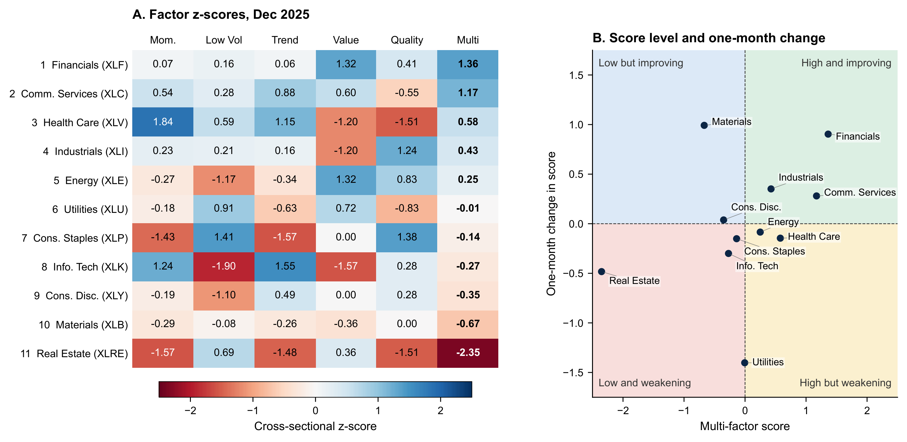
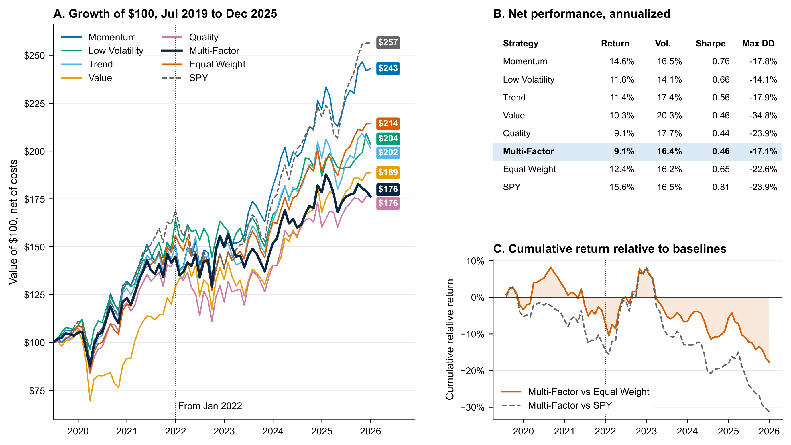
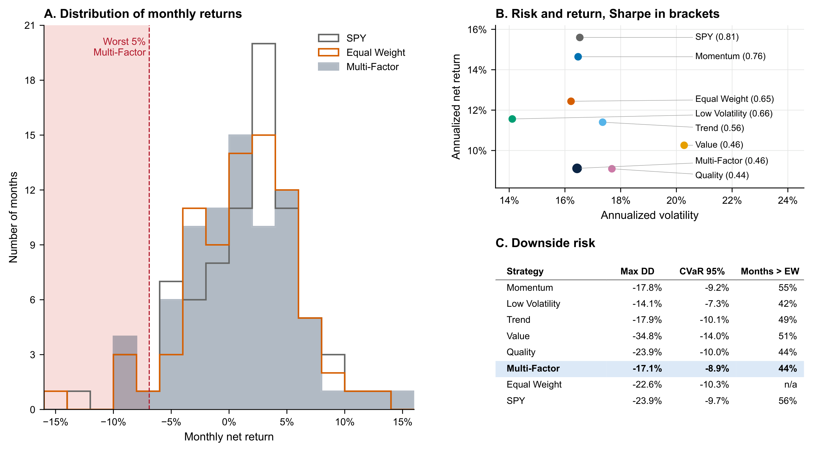
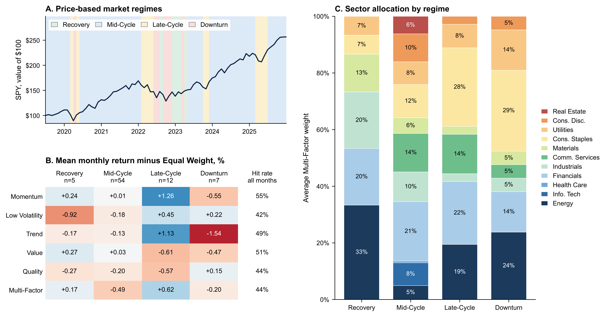

# Sector factor rotation workflow

## Step 1: Prepare the data

Returns include dividends and are taken from `data/raw/etf_monthly_returns.csv` and `data/raw/crsp_d_returns.csv`. Value and quality scores are taken from `data/processed/sector_factor_panel.csv` and the risk-free rate is the one-month Treasury bill. Trend uses a return index because five ETF prices halved in December 2025 with no matching return. The 78-month backtest begins in July 2019, after XLC has 12 full months of returns.

## Step 2: Score the sectors

Momentum is the average of z-scored 3-, 6- and 12-month returns. Low volatility favors lower volatility over 252 days. Trend looks at the return index and compares it with its 10-month moving average. Value and quality use the team's percentile scores, lagged one month. Each factor is a z-score across sectors and the multi-factor score is the average of all five. In December 2025, the highest scores in Figure 1 are for Financials, Communication Services, and Health Care.

**Figure 1. Sector factor scores and one-month changes, December 2025.**

## Step 3: Run the backtest

At the end of every month, each factor strategy purchases its top three sectors at equal weight for one month. The benchmarks are SPY and an equal-weight portfolio of all 11 sectors. Sector portfolios pay 10 basis points for every dollar traded.

## Step 4: Evaluate the strategies

Performance measures include net return, Sharpe ratio, maximum drawdown and turnover. Each gap is tested with a stationary bootstrap of 10,000 draws and a Holm correction is used to account for multiple tests. Market regimes use the signs of prior month-end SPY 12-month and 3-month returns: both positive is mid-cycle, both negative is downturn, only 12-month positive is late-cycle, and only 3-month positive is recovery.

## Results

SPY earned 15.6% a year, more than any sector strategy in Figure 2.

**Figure 2. Net growth and performance by strategy.**

As Table 1 shows, momentum lagged equal weight from 2019 to 2021, and led equal weight from 2022 to 2025.

**Table 1. Net performance and turnover by period.**

| Strategy | 2019 to 2021 return | 2019 to 2021 Sharpe | 2022 to 2025 return | 2022 to 2025 Sharpe | Monthly turnover |
| --- | ---: | ---: | ---: | ---: | ---: |
| Momentum | 17.8% | 0.97 | 12.7% | 0.61 | 29.0% |
| Low Volatility | 21.9% | 1.32 | 5.6% | 0.19 | 4.7% |
| Trend | 17.6% | 0.95 | 7.7% | 0.30 | 29.0% |
| Value | 10.8% | 0.51 | 9.9% | 0.43 | 7.0% |
| Quality | 16.2% | 0.89 | 4.9% | 0.14 | 10.9% |
| Multi-Factor | 15.9% | 0.89 | 5.1% | 0.15 | 30.4% |
| Equal Weight | 19.4% | 1.03 | 8.3% | 0.36 | 1.3% |
| SPY | 23.4% | 1.26 | 11.0% | 0.50 | n/a |

The multi-factor strategy in Figure 3 had a smaller maximum drawdown than equal weight, 17.1% against 22.6%, but a lower Sharpe ratio, 0.46 against 0.65.

**Figure 3. Monthly returns and downside risk.**

The average multi-factor returns in Figure 4 are between 0.49 percentage points a month below equal weight in 54 mid-cycle months and 0.62 points above it in 12 late-cycle months.

**Figure 4. Market regimes, factor return gaps, and sector weights.**

In 11 of 12 sensitivity runs on costs, holdings, lags, timing and signals, equal weight outperformed the multi-factor strategy. The exception used raw ratios and earned 13.2%, but Health Care alone accounts for about 75% of the cross-sector variance in raw return on equity.
